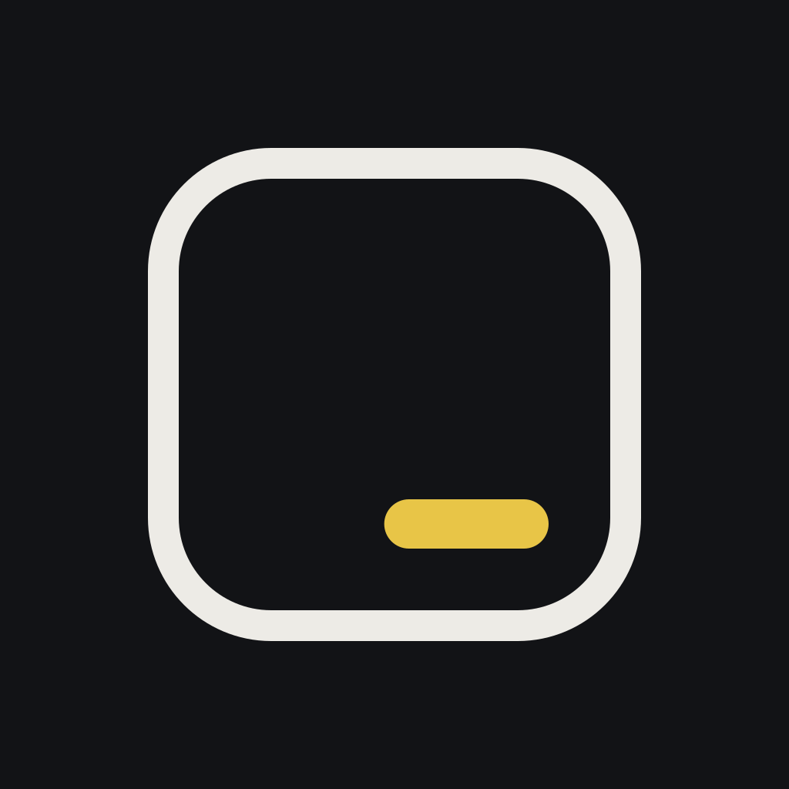
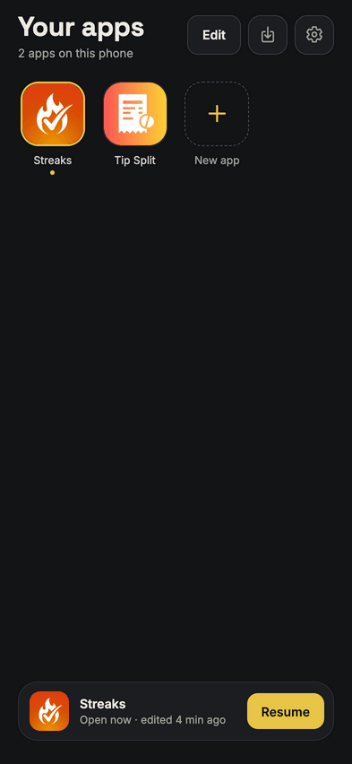
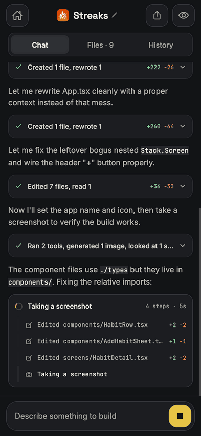
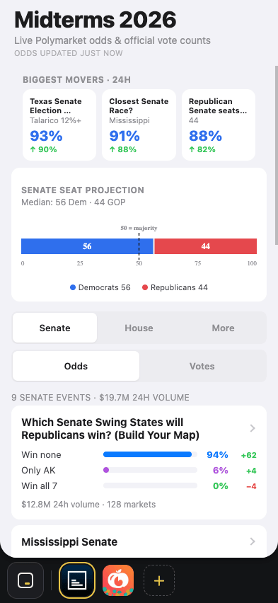

# Blank Slate

<p align="center"></p>

Blank Slate is an experimental app built to make it easier to build personal apps.

In this crazy era of "software is dead" I have found myself building one-off apps for things all the time. Blank Slate lowers the barrier all the way to "run prompt inside Blank Slate -> get app" instead of having to get my laptop out -> set up an Expo project -> run an internal preview build, etc., etc. This fits in a slightly different place than like Lovable et al. It's not intended as a way to make the next SaaS tool, it's just for one-off things you want on your phone.

I see this as an experiment/exploration into what apps will become when phones actually allow fully-personalized apps to exist.

<p>
  
  
  
</p>

## Features

- **Many apps.** A home grid ("Your apps") with a generated icon and name for
  each, and a dock for switching between them without going back home.
- **Agent tools.** Read, write and edit files; generate images; web search and
  fetch; set the app's icon and name.
- **Debugging.** A History tab records what the app did at runtime (logs,
  errors, network, taps). The agent can read that history, take screenshots,
  and inspect the UI tree, so it can check its own work.
- **Design guidance.** Each app has a vibe (Cozy, Bold, Minimal, Playful,
  Retro, or your own words) that the agent turns into a theme. The default is
  an "iOS native" direction: system colours, SF Symbols, and native stack and
  tab navigation.
- **Per-app storage.** AsyncStorage, SQLite and `localStorage` are namespaced
  per app, so apps don't see each other's data.
- **Sharing.** Export an app as a `.blankslate` file and open it on another
  device.
- **Desktop.** The Electron build puts the dock in a left rail with chat in a
  sidebar beside the running app (Cmd+\ hides it). Wide browser windows get
  the same layout.
- **Slate & Chalk.** Blank Slate's own design; see [`design/`](design/README.md).

## Get it on your phone

The easiest way: clone this repo, open it in Claude Code or Codex, and ask:

> Get Blank Slate onto my iPhone.

The agent follows [`docs/install-on-iphone.md`](docs/install-on-iphone.md).
It asks which Apple account you have, runs the commands and checks each step.
It stops and hands over to you for the parts only you can do: signing in to
Expo or Apple, installing a profile on the phone, turning on Developer Mode,
and entering your OpenRouter key.

### Doing it yourself

There are two routes. Full commands, checks and fixes for common problems are
in [`docs/install-on-iphone.md`](docs/install-on-iphone.md).

- **Paid Apple Developer account (recommended):** an EAS build with a free
  [Expo](https://expo.dev) account. Point `app.json` at your own accounts,
  then:

  ```sh
  npm ci
  npx eas-cli@latest login
  npx eas-cli@latest init --non-interactive --force
  npx eas-cli@latest update:configure -p ios --non-interactive
  npx eas-cli@latest device:create          # then install the profile on the phone
  npx eas-cli@latest build -p ios --profile preview
  ```

  Open the install link or QR code on the phone. The `preview` profile gives
  you a standalone app that takes over-the-air updates from
  `npx eas-cli@latest update --branch preview`. The `development` profile
  gives you a dev client that live-reloads JS from `npx expo start`.
- **Free Apple ID:** build with Xcode to a connected iPhone using your
  Personal Team. Free-team apps expire after 7 days and can't have push
  notifications, so you have to remove the push entitlement after
  `expo prebuild`. The doc has the exact steps.

On iOS 16 and later, turn on Developer Mode (Settings → Privacy & Security →
Developer Mode) before opening the app. On first launch, enter an
[OpenRouter API key](https://openrouter.ai/keys). It's stored on the device
only.

If the maintainer invites you as a TestFlight tester you can install it from
there instead. Neither the App Store nor public TestFlight is guaranteed,
because Apple's guideline 2.5.2 restricts apps that run new code. Android is
untested.

## Getting started

### Prerequisites

- Node 20
- Xcode and CocoaPods (for iOS)
- An [OpenRouter API key](https://openrouter.ai/keys). You enter it in the app
  on first launch. It is stored on the device only (Keychain on iOS and
  desktop, `localStorage` in a browser) and sent only to OpenRouter.

### Web

```sh
npm ci
npx expo start --web
```

### iOS simulator

```sh
npm ci
scripts/ios-sim.sh            # uses the booted iPhone simulator
scripts/ios-sim.sh <udid>     # or a specific one (booted if needed)
```

The script prebuilds `ios/` and installs pods if needed, builds the dev
client with `xcodebuild`, installs it, starts Metro and opens the app against
it (or reuses a Metro already on port 8081). It stops rather than guessing
if several iPhone simulators are booted.

It exists because `npx expo run:ios` does not work with Xcode 27 (Simulator is
now DeviceHub) and three pods need `IPHONEOS_DEPLOYMENT_TARGET=15.1`. The
manual equivalent:

```sh
npx expo prebuild -p ios
xcodebuild -workspace ios/BlankSlate.xcworkspace -scheme BlankSlate \
  -configuration Debug -sdk iphonesimulator -destination id=<udid> \
  -derivedDataPath ios/build IPHONEOS_DEPLOYMENT_TARGET=15.1 build
xcrun simctl install <udid> ios/build/Build/Products/Debug-iphonesimulator/BlankSlate.app
npx expo start --dev-client
xcrun simctl launch <udid> org.mikelyons.blank-slate --initialUrl http://localhost:8081
```

### Desktop

See [`desktop/README.md`](desktop/README.md).

### EAS builds

`eas.json` has `development`, `preview` and `production` profiles. `app.json`
points at the maintainer's Expo account and Apple team, so in a fork change
`owner`, `extra.eas.projectId`, `updates.url`, `ios.bundleIdentifier` and
`ios.appleTeamId` to your own before running `eas build`. See step 2 of
[`docs/install-on-iphone.md`](docs/install-on-iphone.md) for the exact edits.

## Architecture

- [`src/agent/`](src/agent) — the agent loop, OpenRouter streaming, tool
  definitions and the system prompt.
- [`src/dynamic/`](src/dynamic) — compiles generated code and resolves its
  imports.
- [`src/vfs/`](src/vfs) — each app's source files and image assets, persisted per app.
- [`src/project/`](src/project) — apps, chats, icons and appearance.
- [`src/sandbox/`](src/sandbox) — per-app storage and globals.
- [`src/debug/`](src/debug) — runtime history, screenshots, UI tree.
- [`src/share/`](src/share) — `.blankslate` export and import.
- [`src/screens/`](src/screens), [`src/theme/`](src/theme) — Blank Slate's
  own UI.
- [`desktop/`](desktop) — the Electron wrapper.

**How generated code runs.** Each file is compiled with Babel standalone
([`transpile.ts`](src/dynamic/transpile.ts)) to CommonJS and evaluated with
`new Function` ([`resolver.ts`](src/dynamic/resolver.ts)). Its `require` goes
through a shim ([`requireShim.ts`](src/dynamic/requireShim.ts)) that only
offers a fixed set of modules (React Native, a list of Expo modules,
navigation, SVG and so on), with storage modules swapped for per-app
versions ([`src/sandbox/`](src/sandbox)). That keeps apps out of each other's
data by accident, but it is not a security boundary: generated code runs in
the same JS realm as Blank Slate, so code written to escape can reach the
real globals, other apps' storage and possibly the OpenRouter key
([`globals.ts`](src/sandbox/globals.ts) spells out what it does and doesn't
cover). Only import `.blankslate` files from people you trust.

## Status

A personal, experimental project. Expect rough edges and breaking changes.

## License

MIT. See [LICENSE](LICENSE).
